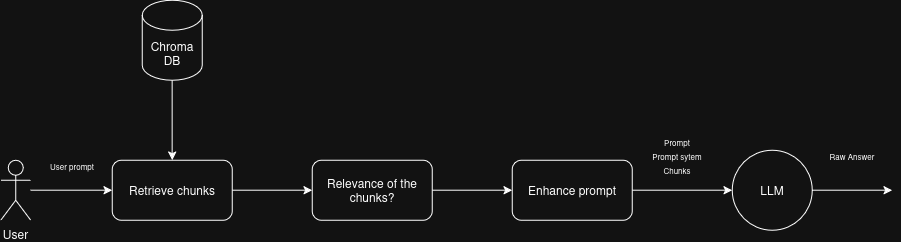
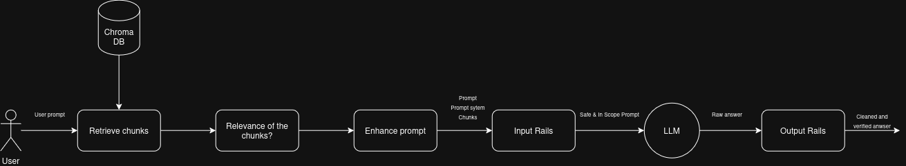
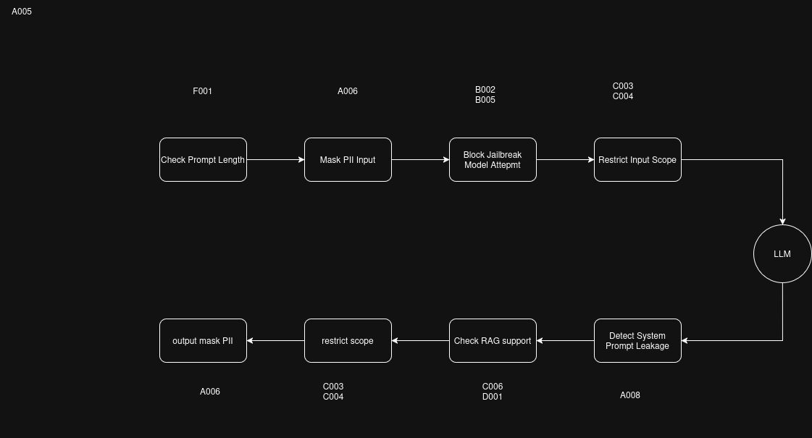

# Document de conception : LLM Guardrails

## 1. Objectif du document

Ce document présente la conception générale d’un assistant LLM sécurisé par des guardrails.

Le document répond aux questions suivantes :

- quel problème cherche-t-on à résoudre ;
- pourquoi utiliser des guardrails autour d’un LLM ;
- quels risques ont été identifiés ;
- quelles protections ont été retenues ;
- quels sont les avantages et limites de ces protections ;
- quelles dettes techniques restent présentes dans le POC.

La documentation technique séparée détaille l’architecture logicielle et les fichiers du projet.

## 2. Contexte général

Le projet consiste à construire un assistant capable de répondre à des questions sur le droit du travail français.

L’assistant s’appuie sur un modèle de langage local et sur une base documentaire considérée comme fiable.
Dans ce contexte, le modèle ne doit pas se comporter comme un chatbot généraliste. Il doit rester dans un périmètre précis, produire des réponses fondées sur les documents fournis, et éviter certains comportements dangereux ou non souhaités.

Un LLM utilisé seul présente plusieurs risques :

- il peut répondre en dehors du domaine prévu ;
- il peut produire une réponse plausible mais non fondée ;
- il peut suivre une instruction malveillante ;
- il peut révéler des instructions internes ;
- il peut manipuler ou reproduire des données personnelles ;
- il peut donner une réponse qui dépasse le rôle attendu de l’assistant.

La conception du projet repose donc sur l’idée suivante :

```text
Le modèle de langage génère une réponse, mais il ne décide pas seul
si une question est acceptable ni si une réponse peut être affichée.
```

Les guardrails ajoutent cette couche de contrôle.

Le schéma suivant représente le fonctionnement classique d’un chatbot LLM avec RAG, sans mécanisme de guardrails :



Le deuxième schéma montre l’évolution du pipeline après l’ajout des rails d’entrée et de sortie :



## 3. Notion de guardrail

Un guardrail est une règle, un contrôle ou un mécanisme placé autour d’un modèle de langage pour encadrer son comportement.

Dans ce projet, les guardrails ne remplacent pas le modèle. Elles servent à réduire les risques associés à son utilisation.

Elles peuvent intervenir à deux moments :

- avant la génération ;
- après la génération.

Les contrôles avant génération sont appelés rails d’entrée.

Les contrôles après génération sont appelés rails de sortie.

Cette séparation est importante, car les risques ne sont pas les mêmes.

Une question utilisateur peut être problématique avant même que le modèle réponde.

Une réponse peut aussi être problématique même si la question était légitime.

## 4. Risques pris en compte

Le projet ne cherche pas à couvrir tous les risques possibles liés aux LLM.

Il cible les risques les plus importants pour un assistant spécialisé :

- question hors périmètre ;
- données personnelles dans la question ou dans la réponse ;
- tentative de jailbreak ou d’injection de prompt ;
- réponse non fondée sur les documents ;
- fuite d’instructions internes ;
- réponse finale hors périmètre.

Chaque risque est traité par une rail dédiée.

Le choix retenu est donc une défense en plusieurs couches.

## 5. Choix d’un framework de guardrails

Le projet utilise un framework spécialisé pour organiser les guardrails.

Le framework retenu est NeMo Guardrails.

Ce choix a été fait parce que le framework permet de représenter clairement un pipeline de contrôle autour d’un modèle de langage.

Il permet notamment de distinguer :

- les contrôles effectués avant la génération ;
- les contrôles effectués après la génération ;
- les messages de refus ;
- les conditions d’arrêt du pipeline.

### Pourquoi ce framework ?

NeMo Guardrails apporte une structure claire au POC.

Il permet de décrire un enchaînement de contrôles sans tout mélanger dans un unique script.

Ce choix est pertinent, car il est possible d’expliquer le pipeline comme une succession de barrières :

```text
question -> contrôles d’entrée -> génération -> contrôles de sortie -> réponse
```

Cette organisation correspond bien à l’objectif du projet : montrer comment un LLM peut être encadré par plusieurs mécanismes de sécurité.


## 6. Architecture conceptuelle

L’architecture retenue repose sur quatre blocs conceptuels :

```text
Question utilisateur
        |
        v
Contrôles d’entrée
        |
        v
Génération par le modèle
        |
        v
Contrôles de sortie
        |
        v
Réponse finale
```

Un mécanisme de RAG est également utilisé pour fournir au modèle des informations issues d’une base de documents.

Le rôle de chaque bloc est différent :

- les contrôles d’entrée décident si la question peut être traitée ;
- le RAG fournit des éléments de réponse ;
- le modèle formule une réponse ;
- les contrôles de sortie décident si cette réponse peut être affichée.

Cette séparation permet d’expliquer clairement chaque responsabilité.

Le schéma suivant détaille l’ensemble des rails ajoutées autour du modèle, en entrée et en sortie :



## 7. Choix du RAG

Le projet utilise une base documentaire pour guider les réponses du modèle.

Ce choix répond au problème des hallucinations.

Dans un domaine juridique, une réponse qui semble correcte mais qui n’est pas fondée sur une source maîtrisée est problématique.

Le RAG permet donc de limiter l’usage des connaissances générales du modèle et de rapprocher les réponses des documents fournis.


### Hypothèse de confiance

Le projet part du principe que la base documentaire est fiable.

Cette hypothèse est importante.

Elle signifie que le projet ne cherche pas actuellement à détecter des instructions malveillantes cachées dans les documents.

Autrement dit, la détection d’injection indirecte dans les extraits documentaires n’est pas couverte dans la version actuelle.


## 8. Décision sur l’intégration du RAG

Au début du projet, le RAG avait été envisagé directement dans le pipeline du framework de guardrails.

Cette approche semblait bonne, car elle aurait permis de centraliser tout le comportement dans le même outil.

Cependant, une limite pratique est apparue.

Le framework n’insérait pas de manière suffisamment maîtrisée le contexte documentaire dans la question traitée. 

La documentation décrit uniquement le RAG intégré basé sur le répertoire kb. Nous avons cependant choisi de développer notre propre RAG, car le mécanisme intégré répondait mal à nos besoins (une latence insupportable même avec un GPU RTX 406).

La décision a donc été de sortir le RAG du pipeline interne du framework et de le gérer avant l’appel aux guardrails.

### Avantages

- meilleure maîtrise de la structure donnée au modèle ;
- distinction plus claire entre question, contexte et instructions ;
- simplification du POC ;
- comportement plus facile à observer et à déboguer.

### Inconvénients

- le RAG est déclenché avant la validation complète de la question ;
- une question qui sera refusée plus tard peut quand même déclencher une recherche documentaire ;
- l’architecture est moins optimale du point de vue de l’ordre des contrôles.

### Dette technique

La dette technique principale est donc la suivante :

```text
Le contexte documentaire est récupéré avant que toutes les rails d’entrée
aient validé la question.
```

Cette dette a été acceptée pour stabiliser le POC et avancer sur les autres mécanismes de sécurité.

Dans une version plus aboutie, une partie des contrôles d’entrée devrait être exécutée avant la récupération documentaire, afin d’éviter les recherches inutiles ou risquées.

## 9. Rails d’entrée retenues

Les rails d’entrée servent à vérifier la question avant la génération.

Elles évitent d’appeler le modèle principal lorsque la demande est non acceptable.

### 9.1 Contrôle de longueur

Le contrôle de longueur limite les questions trop longues.

Avantages :

- protège le système contre des prompts excessivement longs ;
- réduit les coûts et la latence ;
- évite certains abus simples.

Cette rail est simple, mais utile comme première barrière.

### 9.2 Masquage des données personnelles

Le masquage des données personnelles réduit l’exposition d’informations sensibles.

Dans le POC, le système cible principalement les emails et les numéros de téléphone.

Avantages :

- limite la circulation de données personnelles ;
- conserve le sens de la question ;
- améliore la sécurité de la démonstration.

Limites :

- toutes les données personnelles ne sont pas couvertes ;
- les numéros de téléphone et emails publics seront aussi masqués ;

### 9.3 Protection contre les jailbreaks

Cette rail cherche à détecter les instructions qui tentent de modifier le comportement prévu de l’assistant.

Exemples de comportements visés :

- demander au modèle d’ignorer ses règles ;
- demander de révéler ses instructions internes ;
- demander de désactiver les protections.

Avantages :

- bloque certaines attaques avant la génération ;
- protège le rôle de l’assistant ;

Limites :

- le modèle de détection utilisé est générique ;
- il n’est pas spécialisé sur le droit du travail ;
- il peut manquer certaines attaques formulées autrement (par exemple une attaque qui demande le changement du périmètre du chatbot sera difficile à détecter avec ce modèle générique).


### 9.4 Contrôle du périmètre

Le contrôle du périmètre vérifie que la question concerne le droit du travail français.

Avantages :

- empêche l’assistant de devenir généraliste ;
- rend le comportement plus cohérent ;
- améliore la qualité de la réponse.

Limites :

- certaines questions sont ambiguës ;
- les mots-clés seuls ne suffisent pas ;
- latence pour les questions ambiguës qui font appel au juge LLM ;

Le projet combine une comparaison sémantique et un jugement complémentaire pour les cas ambigus.


## 10. Rails de sortie retenues

Les rails de sortie vérifient la réponse après génération.

Elles sont nécessaires parce qu’une question acceptable peut quand même produire une réponse problématique.

### 10.1 Détection de fuite d’instructions internes

Le système utilise un marqueur confidentiel placé dans les instructions internes.

Si ce marqueur apparaît dans la réponse, cela indique une fuite directe.

Avantages :

- contrôle simple ;
- rapide ;
- déterministe ;
- facile à démontrer.

Limites :

- détecte surtout les fuites directes ;
- ne détecte pas forcément une reformulation ;
- ne remplace pas une analyse complète de confidentialité ;


### 10.2 Vérification du support documentaire

Cette rail vérifie que la réponse est suffisamment fondée sur le contexte documentaire fourni.

Elle vise à limiter les hallucinations et les ajouts non justifiés.

Avantages :

- réduit les réponses inventées ;
- renforce le RAG ;
- permet de bloquer une réponse non vérifiable.

Limites :

- le juge peut se tromper, surtout qu'il s'agit d'un petit modèle de 3B de paramètres ;
- un petit modèle peut mal évaluer une reformulation correcte ;
- le contrôle ajoute de la latence.


### 10.3 Contrôle du périmètre de la réponse

Ce contrôle vérifie que la réponse finale reste dans le domaine attendu.

Avantages :

- évite une réponse hors sujet même si la question a été acceptée ;
- ajoute une couche de sécurité après génération ;
- renforce la cohérence globale de l’assistant.

Limites :

- une réponse courte peut être difficile à classer ;
- une réponse partiellement hors sujet peut être mal évaluée ;
- le contrôle dépend de la qualité des exemples et du modèle utilisé.

### 10.4 Masquage des données personnelles en sortie

Cette rail masque les données personnelles qui apparaîtraient dans la réponse.
Le fonctionnement est similaire à celui de l’entrée.

## 11. Choix de modèles locaux

Le projet privilégie des modèles exécutés localement.

Avantages :

- pas de dépendance à une API payante ;
- meilleure maîtrise de l’environnement ;
- données traitées localement ;

Inconvénients :

- performances variables selon la machine ;
- modèles parfois moins fiables que des modèles plus grands ;
- installation plus lourde ;
- consommation mémoire importante ;
- latence plus élevée.

Ce choix correspond au cadre du stage, mais il limite la qualité de certaines décisions automatiques.

## 12. Stratégie de test et d’évaluation

Les tests ont deux rôles.

Le premier rôle est de vérifier que les mécanismes fonctionnent.

Le second rôle est de documenter les limites du système.

Le projet distingue :

- des tests isolés par rail ;
- des tests de comportement global du pipeline.

Les tests isolés permettent d’observer précisément une protection.

Les tests globaux vérifient que les protections fonctionnent ensemble.

Certains tests peuvent échouer à cause des limites des modèles utilisés. Ces échecs ne sont pas toujours des erreurs de code ; ils peuvent révéler une limite du choix de modèle.


## 13. Limites principales

Le POC réduit plusieurs risques, mais il ne garantit pas une sécurité complète.

Les limites principales sont :

- le modèle de jailbreak est générique et non spécialisé sur le droit du travail ;
- la base documentaire est supposée fiable ;
- les injections indirectes dans les documents ne sont pas détectées ;
- le RAG est exécuté avant toutes les validations d’entrée ;
- les modèles locaux peuvent produire des jugements imparfaits ;
- certains cas ambigus de périmètre restent difficiles ;
- les contrôles ajoutent de la latence.


## 14. Perspectives d’amélioration

Les améliorations prioritaires seraient :

- exécuter des contrôles d’entrée rapides avant la récupération documentaire ;
- ajouter une vérification des documents si la base n’est plus entièrement maîtrisée ;
- évaluer un modèle de jailbreak plus adapté au français et au contexte métier ;
- tester des modèles juges plus puissants (par exemple utiliser des API) ;

## 15. Conclusion

Le projet propose une architecture de POC pour encadrer un assistant LLM spécialisé.

La conception repose sur une défense en plusieurs couches :

- contrôler la question ;
- guider la réponse avec une base documentaire ;
- générer une réponse ;
- contrôler la réponse avant affichage.

Le système n’est pas une solution finale, mais il constitue une base claire pour discuter des guardrails, de leurs bénéfices, de leurs limites et des évolutions nécessaires.
